<p align="center">
  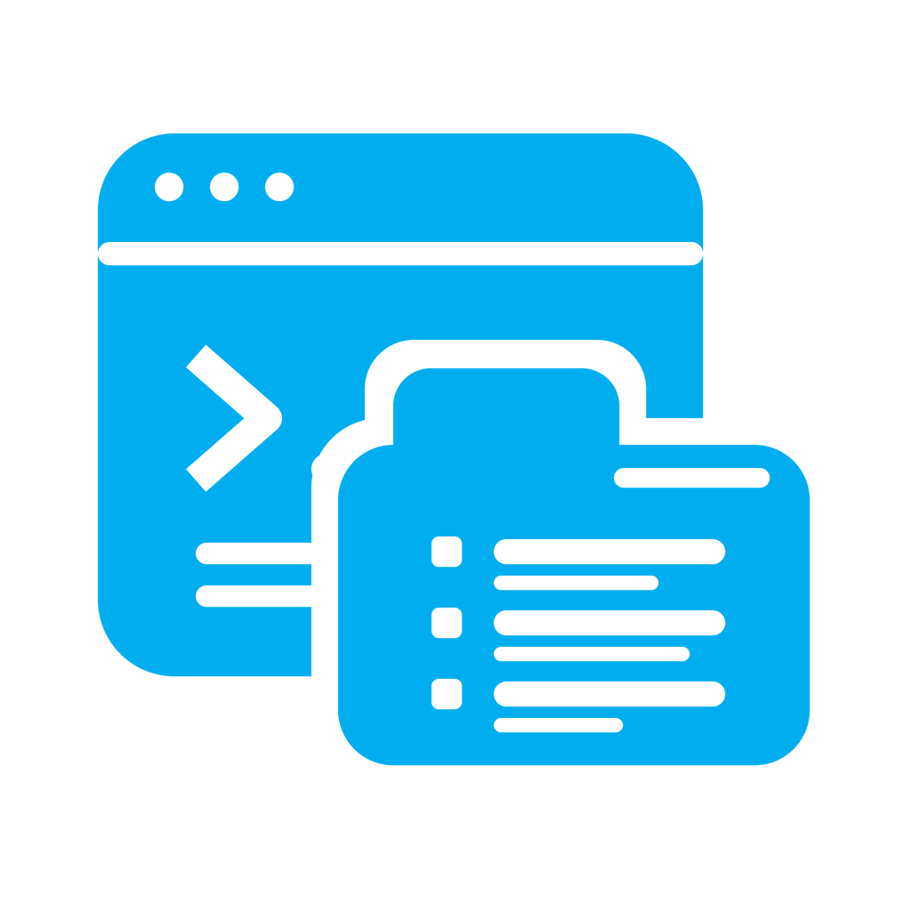
</p>


# Terminal Organizer

[](https://github.com/zbychpo/terminal-organizer-vscode/blob/main/LICENSE)


Terminal Organizer helps you define, launch, and manage repeatable VS Code terminal sessions. Create named sessions for your projects, restore them automatically when VS Code starts, import commands from common project files, and keep terminals recognizable with colors, icons, and themes.


> **Terminal Organizer** is a fork/clone of [**Terminal Keeper**](https://marketplace.visualstudio.com/items?itemName=nguyenngoclong.terminal-keeper), originally created by **Nguyen Ngoc Long**.

<p align="center">
  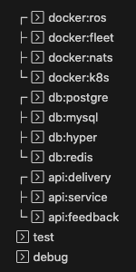
  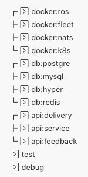
</p>

Terminal Organizer helps you define, launch, and manage repeatable VS Code terminal sessions. Create named sessions for your projects, restore them automatically when VS Code starts, import commands from common project files, and keep terminals recognizable with colors, icons, and themes.


[](https://github.com/sponsors/zbychpo)

## Installation

Install Terminal Organizer from one of these registries:

- [Visual Studio Marketplace](https://marketplace.visualstudio.com/items?itemName=zbigniewpowroznik.terminal-organizer-vscode)
- [Open VSX Registry](https://open-vsx.org/extension/zbigniewpowroznik/terminal-organizer-vscode)

Or install it from within VS Code:

1. Open the Extensions view (`Ctrl+Shift+X` / `Cmd+Shift+X`, or `F1` → "Extensions: Install Extensions").
2. Search for `Terminal Organizer`.
3. Click `Install`.

Or from the command line:

```
code --install-extension zbigniewpowroznik.terminal-organizer-vscode
```

## Why use Terminal Organizer?

Terminal Organizer is useful when you often open the same terminals for a project, such as a dev server, test watcher, background worker, or documentation server. Instead of reopening and retyping commands manually, save those workflows as sessions and activate them when you need them.

It's aimed at developers who frequently work in the terminal inside VS Code and want more control over that workflow - whether you're on a solo project or a larger team, switching between sessions and re-running the same setup should take one command, not several minutes of retyping.

## Highlights

* 🚀 **Launch repeatable terminal workflows** with a single command.
* 🔄 **Automatically restore sessions** whenever VS Code starts.
* 🗂️ **Organize terminals into named sessions** for different projects or environments.
* 📥 **Import commands** from `package.json`, `composer.json`, `Makefile`, `Pipfile`, Gradle, Ant, Grunt, Gulp, and more.
* 🎨 **Customize terminal colors and icons** or let Terminal Organizer generate them automatically.
* ⌨️ **Run terminals directly from keyboard shortcuts** using built-in keybinding support.
* 🧩 **Works with both Visual Studio Marketplace and Open VSX.**
* 🚫 **No ads. No telemetry. No unnecessary setup.**

## Features

### Session Management

* **Named terminal sessions** – Organize terminals into reusable sessions for different workflows.
* **Automatic startup activation** – Restore your preferred session automatically when VS Code starts.
* **Session picker** – Quickly switch between saved sessions from the Command Palette.
* **Session cleanup** – Remove sessions you no longer need with a single command.

### Productivity

* **Workspace configuration** – Generate a starter configuration and customize it for each workspace.
* **Command importing** – Import commands from common project files instead of writing them manually.
* **Activity Bar integration** – Create, edit, activate, copy, import, and manage sessions from a dedicated explorer view.
* **Keybinding support** – Launch a terminal or session directly from your own keyboard shortcuts.
* **Quick Run button** – Adds a button to the terminal tab for activating a session without leaving the terminal panel.

### Customization

* **Terminal themes** – Assign colors and icons manually or let Terminal Organizer generate consistent themes automatically.
* **Split terminal layouts** – Define both regular and split terminals inside a session.
* **Flexible terminal options** – Configure working directory, environment variables, shell, focus behavior, startup messages, and more.

## Quick start

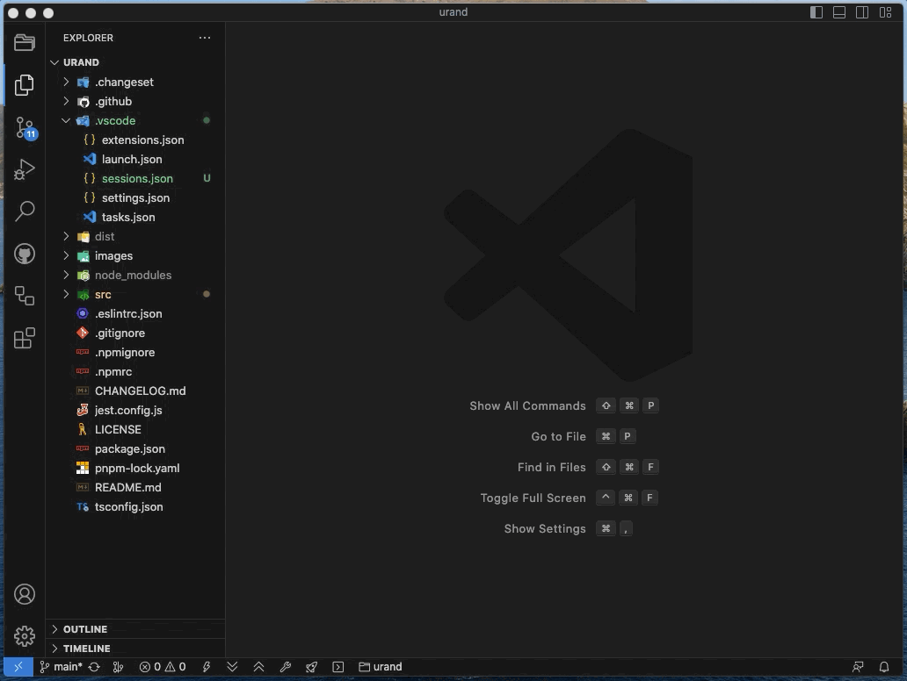

1. Open the Command Palette using Ctrl + Shift + P (Windows) or Cmd + Shift + P (macOS).
2. Type Terminal Organizer and select your desired action, such as:
   - Generate Configuration
   - Open Configuration
   - Activate Session
   - Import Session
   - Remove Session

> If this is your first time using Terminal Organizer, you'll be prompted to generate a configuration. Choose "Yes" to create and customize your settings.

A typical workflow looks like this:

1. Generate a configuration file for the current workspace.
2. Add or edit sessions in the generated configuration.
3. Activate a session from the Command Palette or Terminal Organizer Activity Bar view.
4. Reuse that session whenever you return to the project.

### Built-in themes

<p align="center">
  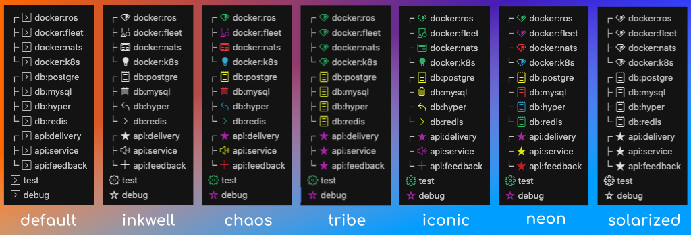
</p>

Built-in themes automatically assign consistent colors and icons to terminals based on their names, making large workspaces much easier to navigate at a glance.
Prefer a different look every time? Switch to the **Dice** theme for randomly generated colors and icons.

### Activity Bar integration ✨

Manage all your terminal sessions from a dedicated Activity Bar view. Create, edit, activate, duplicate, reorder, import, or remove sessions and terminals without leaving the explorer.


### Import sessions from project files ✨

Skip the manual setup by importing commands directly from common project files such as `package.json`, `composer.json`, `Makefile`, `Pipfile`, Gradle, Ant, Grunt, Gulp, and VS Code's own `.vscode/tasks.json`. Re-importing into the same session updates any terminal whose name already matches instead of duplicating it.

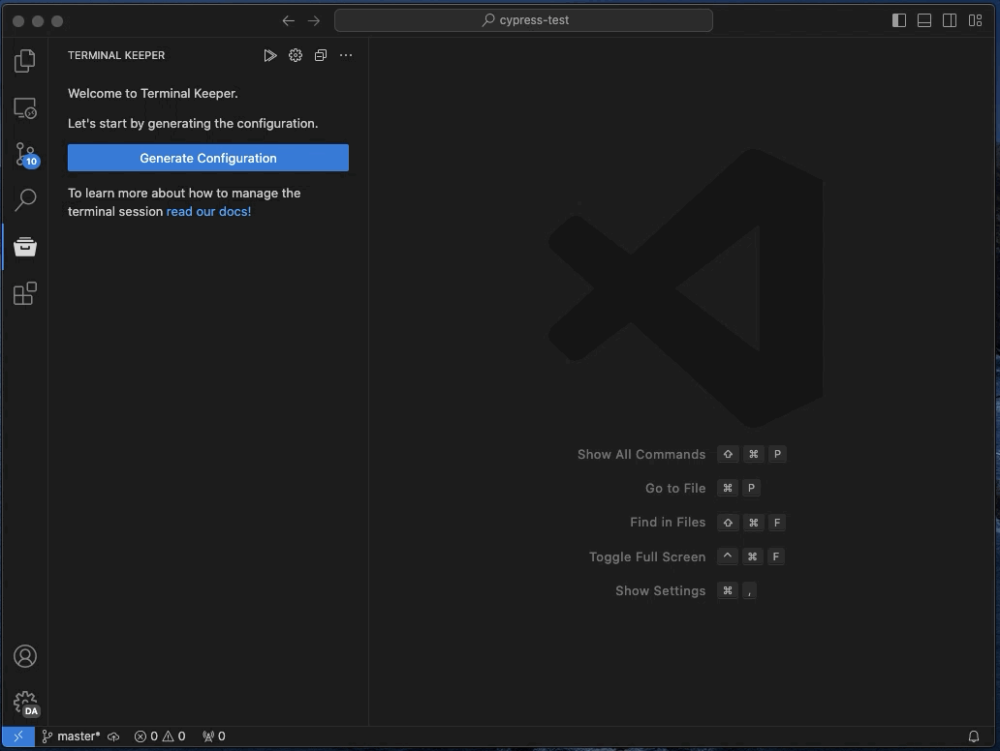

### Generate configuration

Generate a ready-to-use configuration file for the current workspace, starting with a single empty `default` session so you can build it up from scratch - add terminals through the Activity Bar or by importing commands from a project file.

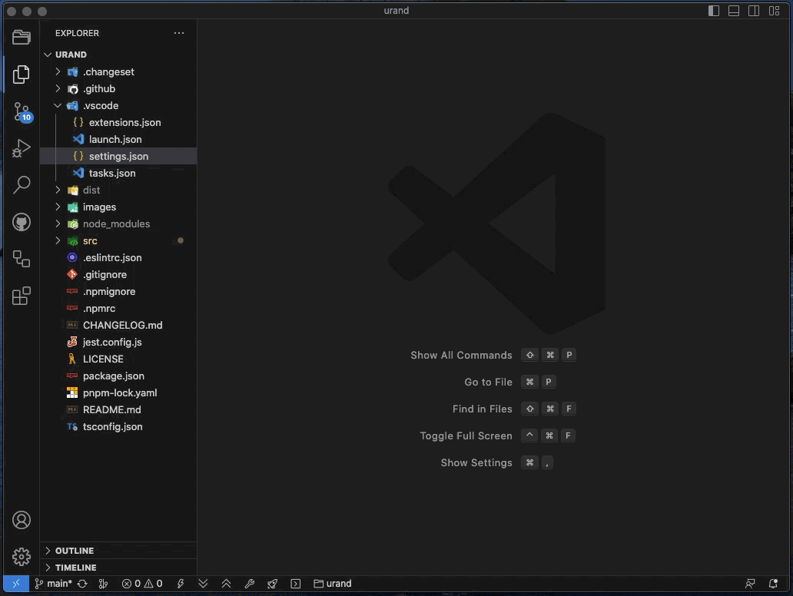

### Activate on startup

Automatically restore your preferred terminal session whenever you open the workspace, so your development environment is ready to go immediately.


### Distinct random colors and icons

Keep terminals easy to distinguish with automatically generated colors and icons. Every terminal gets its own visual identity without any manual configuration.

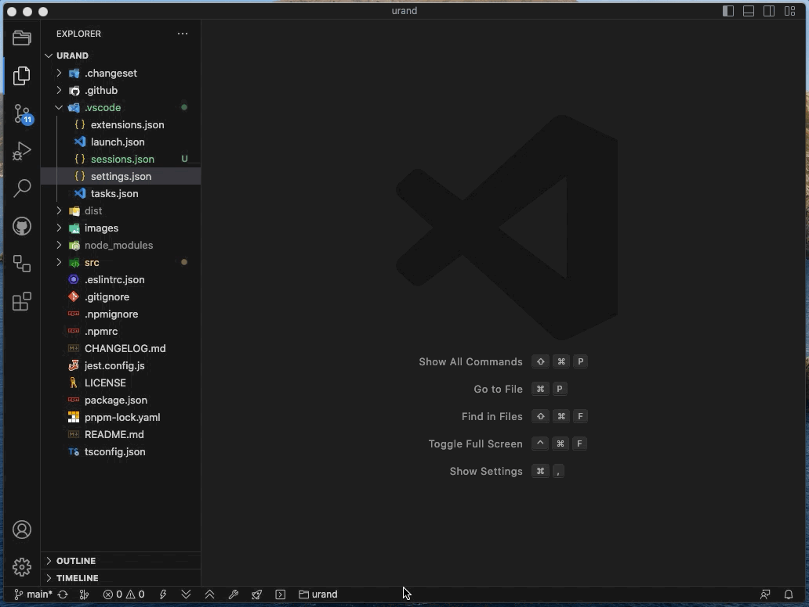

### Choose a session to activate

Quickly switch between multiple saved sessions using the Command Palette. Perfect for projects with different development, testing, or deployment workflows.


Need more than one session running together? **Activate Multiple Sessions** (also available from the Activity Bar's title bar, next to **Active Session**) lets you check off several sessions at once and activates them one after another without killing the terminals from the sessions activated just before it.

### Launch sessions in any workspace directory

Start a session from the current workspace or any folder you choose, making it easy to reuse the same configuration across multiple projects.

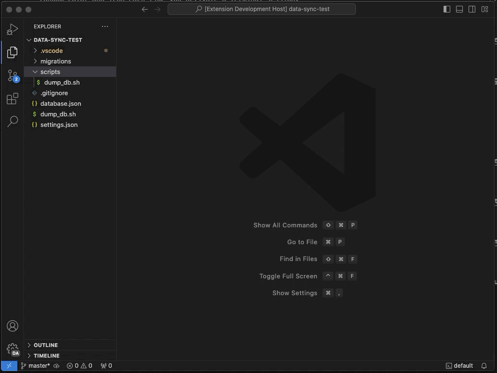

### Remove unwanted sessions

Keep your configuration clean by deleting sessions you no longer use directly from the Command Palette or Activity Bar.

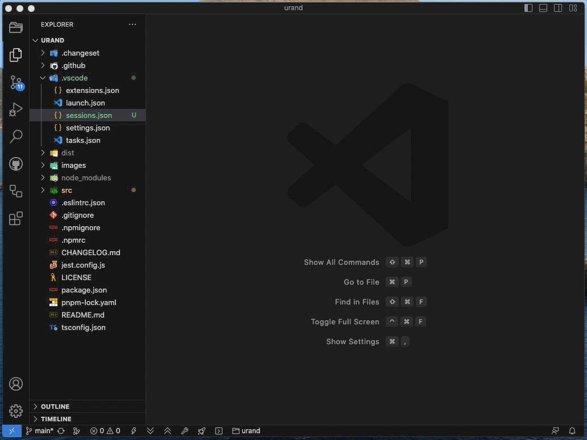

### Quick configuration access

Open your Terminal Organizer configuration with a single command whenever you need to review or update your sessions.

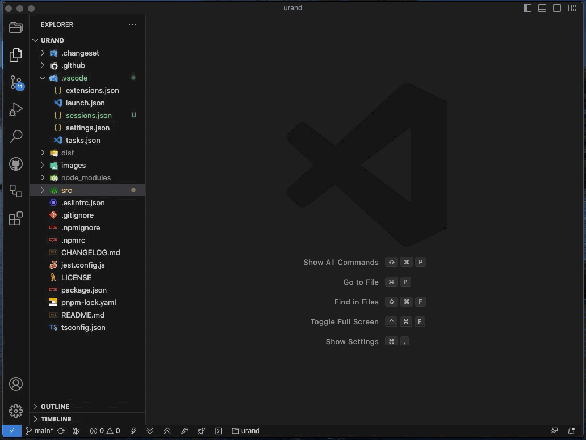

Each setting under the Activity Bar's **Global Configs** group also has an inline **edit** (pencil) button, so you don't have to open `sessions.json`/`settings.json` by hand: it picks the right control for the setting - Yes/No for on/off settings, a theme picker for `theme`, a session picker for `active`, and a multi-select list (Global Configs, Variables, Environments, session names, split-terminal group names, environment names) for `openNodeOnStart`.

## Configuration

Terminal Organizer stores sessions in a configuration object. Each session contains one or more terminals. Use an object for a normal terminal, or an array of terminal objects when you want split terminals.

```ts
{
    // Used to determine which session to use.
    active: string,

    // Activated the session when Visual Studio Code starts up.
    activateOnStartup: boolean,

    // Keep existing terminals open when a session is executed.
    keepExistingTerminals: boolean,

    // Skip running the clear command during initialization.
    noClear: boolean,

    // Default operator used to join a terminal's multiple commands (e.g. ";", "&&", "||")
    // when the terminal doesn't specify its own "joinOperator" (see Terminal options below).
    // A terminal's own "joinOperator" always overrides this global value.
    joinOperator: string,

    // List of node names (e.g. "Sessions", "Variables", "Environments", a session name,
    // an environment name, or a split-terminal group name) that will be expanded by
    // default in the Activity Bar explorer view.
    openNodeOnStart: Array<string>,

    // Theme used to assign terminal colors and icons.
    theme: string,

    // List of terminal sessions. Multiple sessions can be defined, but default must always exist.
    sessions: {

        // The default session
        default: [
            // Define the Non Split Terminal
            {
                name: string,
                commands: Array<string>
                // For more options, you can refer to the Terminal Options section.
            },

            // Define the Split Terminal
            [
                {
                    name: string,
                    commands: Array<string>
                },
                {
                    name: string,
                    commands: Array<string>
                }
            ]
        ],

        // Your defined session
        custom: [
            {
                name: string,
                commands: Array<string>
            },
            [
                {
                    name: string,
                    commands: Array<string>
                },
                {
                    name: string,
                    commands: Array<string>
                }
            ]
        ]
    },
    variable: {
        name: string,
        
    },

    // The name of the environment (from "environments") merged into every
    // terminal's env before a session is activated.
    activeEnvironment: string,

    // Named sets of environment variables. See the "Environments" section below.
    environments: {
        name: {
            // Optional: names of other environments to inherit variables from, least to most important.
            inherits?: Array<string>,
            // Optional: names of this environment's own variables to mask in the Activity Bar.
            mask?: Array<string>,
            NAME: string
        }
    }
}
```

### Terminal options

Most terminal options mirror the VS Code terminal API. Common options are `name`, `commands`, `cwd`, `color`, `icon`, and `focus`.

```ts
// A human-readable string which will be used to represent the terminal in the UI.
name: string,

// Free-text notes shown in the terminal's tooltip in the Activity Bar (not passed to the terminal).
// A string for one line, or an array of strings for several lines (one line per item).
// "Edit Terminal" -> "description" opens it in an editor; every save (Ctrl+S) applies it.
description?: string | Array<string>,

// The command list.
commands: Array<string>,

// The operators to join multiple commands. e.g. semicolon (;), logical OR (||), logical AND (&&) and more.
// Overrides the top-level "joinOperator" for this terminal only. If neither is set, defaults
// to "&" on Windows and ";" elsewhere.
joinOperator?: string,

// Automatically execute the specified commands.
autoExecuteCommands?: boolean,

// A path or Uri for the current working directory to be used for the terminal.
cwd?: string,

// The id of the color. The available colors are listed in https://code.visualstudio.com/docs/getstarted/theme-color-reference.
color?: string,

// The id of the icon. The available icons are listed in https://code.visualstudio.com/api/references/icons-in-labels#icon-listing.
icon?: string,

// Object with environment variables that will be added to the editor process.
env?: object,

// When enabled the terminal will run the process as normal but not be surfaced to the user until Terminal.show is called. The typical usage for this is when you need to run something that may need interactivity but only want to tell the user about it when interaction is needed. Note that the terminals will still be exposed to all extensions as normal.
hideFromUser?: boolean,

// Opt-out of the default terminal persistence on restart and reload. This will only take effect when terminal.integrated.enablePersistentSessions is enabled.
isTransient?: boolean,

// A message to write to the terminal on first launch, note that this is not sent to the process but, rather written directly to the terminal. This supports escape sequences such a setting text style.
message?: string,

// Args for the custom shell executable. A string can be used on Windows only which allows specifying shell args in command-line format.
shellArgs?: Array<string>,

// A path to a custom shell executable to be used in the terminal.
shellPath?: string,

// Whether the terminal process environment should be exactly as provided in TerminalOptions.env. When this is false (default), the environment will be based on the window's environment and also apply configured platform settings like terminal.integrated.env.windows on top. When this is true, the complete environment must be provided as nothing will be inherited from the process or any configuration.
strictEnv?: boolean,

// Focused the terminal on startup.
focus?: boolean,

// ✨ When true, this terminal will be disabled and not launched during an active session. Useful for temporarily turning off terminals without removing them.
disabled?: boolean
```

Every field above can be edited without touching `sessions.json` by hand: use the inline **Edit Terminal** ($(edit)) button on a terminal in the Activity Bar's **Sessions** tree. The field picker shows each field's current value plus a one-line description of what it does (what this README's comments describe), so you don't need to come back here to remember what e.g. `strictEnv` or `isTransient` means. Each field then gets the control that fits it: Yes/No for the boolean fields (`disabled`, `autoExecuteCommands`, `focus`, `hideFromUser`, `isTransient`, `strictEnv`), a color picker for `color`, a searchable picker (showing every option's actual glyph) for `icon`, a folder/file-aware input for `cwd`/`shellPath`, and a JSON input for `commands`/`shellArgs` (an array, e.g. `["npm install", "npm run build"]`) and `env` (an object, e.g. `{"NODE_ENV": "production"}`); the remaining fields (`name`, `joinOperator`, `message`) use a plain text input. Leaving an optional field's prompt empty clears it back to its default. Sessions also have an inline **Add Session** ($(add)) button on the **Sessions** group (prompts for a name and creates it empty) and an inline **Add Terminal** ($(add)) button on each session (appends a new standalone terminal) and each split-terminal group (appends a new terminal to that group); both prompt for a name validated against every terminal name already used in any session. Sessions, split-terminal groups, and individual terminals (standalone or inside a group) all have inline **Move Up**/**Move Down** buttons to reorder them.

### Specify terminal icon and color

- Built-in icons: https://code.visualstudio.com/api/references/icons-in-labels#icon-listing
- Built-in colors: https://code.visualstudio.com/api/references/theme-color#integrated-terminal-colors

```json
{
  "active": "default",
  "sessions": {
    "default": [
      {
        "name": "dev",
        "icon": "account",
        "color": "terminal.ansiBlue",
        "commands": []
      }
    ]
  }
}
```

### Variables

Define named string values once in a top-level `variable` object, then reuse them anywhere in a session field (`cwd`, `commands`, `env`, ...) with `${variable:NAME}`:

```jsonc
{
    "variable": {
        "apiRoot": "${workspaceFolder}\\api"
    },
    "sessions": {
        "default": [
            {
                "name": "api",
                "cwd": "${variable:apiRoot}",
                "commands": ["npm run dev"]
            }
        ]
    }
}
```

A variable's value can reference other variables (including global ones), to any depth: with `"jdk": "C:/tools/jdk-21"` and `"javaBin": "${variable:jdk}/bin"`, `${variable:javaBin}` resolves to `C:/tools/jdk-21/bin`. A circular reference (`a` -> `b` -> `a`) is left unresolved instead of looping.

Manage variables from the Activity Bar's **Variables** section: the **+** button on the group adds one (with a folder-picker button to fill in a file/folder path instead of typing it), and each variable has inline **edit**/**remove** actions.

The group also has an **import** (cloud-download) button that reads a `.env`-style file (comments, `export` prefixes, and single/double-quoted values are all handled) and adds every `KEY=value` line as a variable. After importing, you're asked for an environment name (pre-filled from the file name) - if you provide one, an entry is added to `environments` with the same keys pointing back at the imported variables via `${variable:NAME}`, so you get a ready-to-activate environment instead of two copies of the same values:

```jsonc
// Imported from ".env" containing JAVA_HOME=... and MAVEN_HOME=...
{
    "variable": {
        "JAVA_HOME": "C:\\Program Files\\Java\\jdk-17",
        "MAVEN_HOME": "C:\\Program Files\\Apache\\maven-3.9"
    },
    "environments": {
        "env": {
            "JAVA_HOME": "${variable:JAVA_HOME}",
            "MAVEN_HOME": "${variable:MAVEN_HOME}"
        }
    }
}
```

Session fields (and `variable` values themselves) also understand a few of VS Code's own [predefined variables](https://code.visualstudio.com/docs/editor/variables-reference), such as `${workspaceFolder}`, `${workspaceFolderBasename}`, `${userHome}`, `${pathSeparator}`/`${/}`, and `${env:NAME}` - see the [full configuration guide](docs/manage/configuration.md) for details.

### Global variables ✨

Variables you need in every project (a JDK path, a tools directory, ...) can be defined once in the **Global Variables** group at the bottom of the Activity Bar tree. Use the inline **Add Global Variable** button on the group, and the **Edit**/**Remove** buttons on each entry.

They are saved in your **user** settings, not in any `sessions.json`:

```json
"terminal-organizer-vscode.globalVariables": {
    "javaHome": "C:/Java/jdk-21",
    "tools": "${userHome}/tools"
}
```

- Use them like project variables: `${variable:javaHome}` works in commands, `cwd`, `env`, environments, etc. of every project in every workspace.
- A project's own `variable` with the same name wins. In a multi-root workspace with `multiRootMode: "inherit"` the order is: global → workspace-level → folder. An entry that some project overrides shows "overridden in: …" in the tree.
- `${workspaceFolder}` inside a global variable resolves to the folder of the project that uses it.
- The setting is application-scoped, so it can't be set in workspace settings or committed with a project.

### Environments ✨

Define named sets of environment variables once in a top-level `environments` object, then mark one of them `activeEnvironment`. The active environment is automatically merged into **every** terminal's `env` right before a session is activated - no need to repeat `JAVA_HOME`/`MAVEN_HOME`/`PATH` on each terminal that needs them:

```jsonc
{
    "activeEnvironment": "java17",
    "environments": {
        "java17": {
            "JAVA_HOME": "${variable:javaHome}",
            "MAVEN_HOME": "${variable:mavenHome}",
            "PATH": "${variable:javaHome}\\bin;${variable:mavenHome}\\bin;${env:PATH}"
        },
        "java8": {
            "JAVA_HOME": "C:\\Program Files\\Java\\jdk1.8.0",
            "PATH": "C:\\Program Files\\Java\\jdk1.8.0\\bin;${env:PATH}"
        }
    },
    "variable": {
        "javaHome": "C:\\Program Files\\Java\\jdk-17",
        "mavenHome": "C:\\Program Files\\Apache\\maven-3.9"
    },
    "sessions": {
        "default": [
            {
                "name": "build",
                "commands": ["mvn clean install"]
            }
        ]
    }
}
```

A terminal can still define its own `env` - only the keys it **doesn't** already define are filled in from the active environment, and any key it does define wins:

```jsonc
{
    "name": "build",
    "commands": ["mvn clean install"],
    "env": {
        // Overrides the active environment's JAVA_HOME for this terminal only.
        "JAVA_HOME": "C:\\Program Files\\Java\\jdk1.8.0",
        // A terminal-only variable the active environment doesn't define.
        "ILE_ELEMENTO": "10"
    }
}
```

With the `java17` environment above active, this terminal ends up with `JAVA_HOME=C:\Program Files\Java\jdk1.8.0` (its own value), plus `MAVEN_HOME` and `PATH` filled in from `java17`, plus `ILE_ELEMENTO=10`.

Manage environments from the Activity Bar's **Environments** section: the **+** button on the group adds one, and each environment has inline actions to set it as **active** (✓), **duplicate** it, **edit** its inheritance ($(type-hierarchy)), **add** a variable to it, or **remove** it entirely; each variable inside an environment has inline **toggle mask** ($(eye)), **edit**, and **remove** actions. The Sessions tree's per-terminal tooltip shows the resulting merged `env` - i.e. exactly what will be passed to the terminal once the active environment and any variables are resolved.

#### Environment inheritance ✨

An environment can inherit variables from one or more other environments via `inherits`, a list of environment names. Environments listed later override values from environments listed earlier, and the environment's own variables always win over anything inherited:

```jsonc
{
    "activeEnvironment": "java17-verbose",
    "environments": {
        "base": {
            "PATH": "${env:PATH}"
        },
        "java17": {
            "inherits": ["base"],
            "JAVA_HOME": "${variable:javaHome}",
            "PATH": "${variable:javaHome}\\bin;${env:PATH}"
        },
        "java17-verbose": {
            // "logging" is applied after "java17", so its LOG_LEVEL wins if both defined it.
            "inherits": ["java17", "logging"],
            "LOG_LEVEL": "debug"
        },
        "logging": {
            "LOG_LEVEL": "info"
        }
    }
}
```

Here `java17-verbose` ends up with `JAVA_HOME`/`PATH` from `java17` (which itself pulled `PATH` from `base`), `LOG_LEVEL=info` from `logging`, then its own `LOG_LEVEL=debug` overrides that last. A circular chain (e.g. two environments inheriting from each other) is rejected when you edit the inheritance list.

Use the inline **Edit Inheritance** ($(type-hierarchy)) button on an environment to check the other environments it should inherit from - the picker lists every other environment (the current one is never offered), pre-checked with its current `inherits`, with already-inherited environments kept first in their existing precedence order followed by the rest; a selection that would create a circular chain is rejected.

#### Masking environment variable values ✨

If an environment holds a secret (an API key, a token, a password), set `mask` to the list of that environment's own variable names whose value shouldn't be shown in the Activity Bar:

```jsonc
{
    "environments": {
        "prod": {
            "mask": ["API_KEY"],
            "API_KEY": "sk-live-...",
            "API_BASE_URL": "https://api.example.com"
        }
    }
}
```

`API_KEY` then shows as `••••••••` in the environment's own tree row, its tooltip, and the resolved `env` shown in every terminal tooltip that merges this environment in (directly or through `inherits` - masking a variable on a base environment also masks it for anything that inherits from it). This is purely a display concern: the real value is still substituted and used when a terminal actually launches. Toggle it from the inline **toggle mask** ($(eye)) button on an environment variable - the button's own icon switches between $(symbol-variable) and $(eye-closed) to show the current state.

### Multi-root workspaces ✨

In a multi-root workspace every folder can have its own sessions file, and the workspace itself can have a shared one:

```
my-app/
├── my-app.code-workspace
├── .vscode/sessions.json        <- workspace-level (shared) configuration
├── frontend/.vscode/sessions.json
├── backend/sessions.json
└── infrastructure/              <- no sessions file
```

- Each folder is looked up at the locations in `terminal-organizer-vscode.sessionFileLocations` (default: `.vscode/sessions.json`, then `sessions.json`); the first existing file wins and a new one is created at the first location.
- The workspace-level file lives next to the `.code-workspace` file, at the same locations. It is only used when that directory isn't itself one of the workspace folders.
- The Activity Bar shows one node per project (the workspace-level one first), each with its own **Global Configs**, **Sessions**, **Variables** and **Environments**. A project without a sessions file has an inline **Generate Configuration** button. A single-folder workspace looks exactly as before.
- Commands run from the command palette or the view title act on the project of the active editor, or ask you to pick one. **Import** writes into the project the imported file belongs to. A relative `cwd` and a bare `${workspaceFolder}` resolve against the terminal's own project folder.
- **Run Terminal by Name** searches every project; pass `"project": "<folder name>"` in the keybinding args to narrow it down.

`terminal-organizer-vscode.multiRootMode` controls how the files relate. The current mode is shown at the top of the Activity Bar tree (**Multi-root mode: separate/inherit**); hover over it for a description, click it to open the setting, or use its inline **Change Multi-root Mode** button to switch (saved in the workspace settings, i.e. the `.code-workspace` file):

| Value | Behavior |
|---|---|
| `separate` (default) | Every folder uses only its own sessions file. |
| `inherit` | Every folder inherits `variable` and `environments` from the workspace-level file (key by key, the folder wins), plus `theme`, `keepExistingTerminals`, `noClear`, `joinOperator` and `activeEnvironment` when it leaves them unset. A folder without its own file falls back to the workspace-level one. Sessions are never merged. Inherited variables and environments are shown read-only in the folder's tree, marked "from &lt;workspace&gt;". |

The session-related settings (`active`, `activateOnStartup`, `keepExistingTerminals`, `noClear`, `joinOperator`, `openNodeOnStart`, `theme`) are resource-scoped, so a folder's `.vscode/settings.json` can override the workspace's.

### Keybinding support

Run specific terminals directly via keyboard shortcuts by adding custom keybindings to your `keybindings.json`:

```json
{
  "key": "ctrl+shift+t",
  "command": "terminal-organizer-vscode.run-terminal-by-name",
  "args": { "name": "dev-server", "session": "default" }
}
```

| Argument  | Required | Description                                                                    |
| --------- | -------- | ------------------------------------------------------------------------------ |
| `name`    | No       | Terminal name to run. If omitted, shows a picker with all available terminals. |
| `session` | No       | Limit search to a specific session.                                            |

### Optional: hide terminal commands in Explorer descriptions

By default, Terminal Organizer shows the commands for each terminal as a description in the explorer tree view. If you prefer a cleaner look, you can hide these descriptions by setting the following option in your VS Code settings:

```json
"terminal-organizer-vscode.hideCommandsInExplorerDescriptions": true
```

This will remove the command text from the explorer tree items, showing only the terminal names.

## Troubleshooting

### See what was launched, and where each value came from

Turn on `"terminal-organizer-vscode.logLaunches": true`. Every session or terminal launch is then logged to the **Terminal Organizer** output channel (**Terminal Organizer: Show Launch Log**, also in the Activity Bar's `...` menu):

```text
Launching session "dev" in project "backend"
  sessions file:   C:\repo\backend\.vscode\sessions.json
  options:         theme=tribe (project .vscode/sessions.json), keepExistingTerminals=false (settings.json), noClear= (default), joinOperator=&& (workspace-level sessions.json (repo))
  environment:     "dev" (activeEnvironment from project .vscode/sessions.json) → inherits: base
  ▸ terminal "api"
      cwd:         ${variable:apiRoot}/src → C:\repo\backend\src
      commands:    npm run ${variable:script} → npm run dev
      variables:
        apiRoot = C:\repo\backend   ← project .vscode/sessions.json
        script = dev   ← global variables (user settings)
      env:
        TOKEN = ••••••••   ← environment "base" (via dev)
        PORT = 3000   ← terminal's own env
```

Unresolved placeholders (such as a misspelled `${variable:...}`) and a `cwd` that doesn't exist are reported as warnings. Masked environment values, and any variable that feeds one, stay masked.

### `posix_spawnp failed` terminal launch error

If you see this VS Code message:

```text
The terminal process failed to launch: A native exception occurred during launch (posix_spawnp failed.).
```

The failure means VS Code could not start a terminal process. It is usually caused by shell configuration, PATH issues, or conflicts with local system tools. It can also come from the terminal's own options in `sessions.json`. (`posix_spawnp` is the macOS/Linux wording; on Windows the same kind of failure is reported differently, e.g. as a ConPTY/WinPTY error.)

Try these steps first:

1. If only terminals started by Terminal Organizer fail, check the failing terminal's `shellPath`, `shellArgs` and `cwd` in `sessions.json`. A shell path that doesn't exist or arguments that the shell rejects produce exactly this error. Remember that `${variable:NAME}` and `${workspaceFolder}` are substituted into these fields before launch, so check the variable's value too. Hovering over the terminal in the Activity Bar shows its resolved commands and `env`.
2. Close all VS Code windows and reopen the project.
3. Restart your computer if the issue continues.
4. Check your VS Code terminal profile and shell path settings.
5. Review the official VS Code terminal troubleshooting guide: https://code.visualstudio.com/docs/supporting/troubleshoot-terminal-launch

Please open a Terminal Organizer issue only if the terminal launches normally without this extension, and also fails with the same `shellPath`/`shellArgs`/`cwd` set in a regular VS Code terminal profile, but fails specifically when Terminal Organizer activates a session.

### Sessions, variables or settings are missing from the Activity Bar

If the Activity Bar shows the groups but your sessions, variables or environments are missing (or a project's node looks empty), the `sessions.json` file most likely isn't valid JSON. The file is read with a strict JSON parser, so comments and trailing commas aren't allowed. A file that fails to parse is treated as empty, without an error message:

```jsonc
"openNodeOnStart": [
    "default",   // <- trailing comma: the whole file is ignored
],
```

Open the file (**Open Configuration**). VS Code's JSON validation underlines the problem, and the schema shows any unknown keys.

### A project's sessions file isn't picked up in a multi-root workspace

- Each project must be its own folder in the `.code-workspace` file. Subdirectories of a single opened folder aren't searched, so `my-app/backend/sessions.json` is ignored when `my-app` is opened as one folder.
- The file must be at one of the locations in `terminal-organizer-vscode.sessionFileLocations` (default: `.vscode/sessions.json`, then `sessions.json`), relative to that folder. If both exist, the first one in the list is used.
- The workspace-level file is only used when it sits next to a saved `.code-workspace` file whose directory isn't itself one of the workspace folders.
- Variables, environments and options from the workspace-level file only reach the folders when `terminal-organizer-vscode.multiRootMode` is `inherit`. In the default `separate` mode every folder uses only its own file.

## Feedback

If you discover a bug, or have a suggestion for a feature request, please
submit an [issue](https://github.com/zbychpo/terminal-organizer-vscode/issues).

## License

This extension is licensed under the [MIT License](https://github.com/zbychpo/terminal-organizer-vscode/blob/HEAD/LICENSE)
